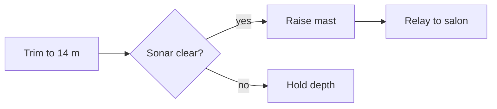

# Nautilus OS: Periscope

**Owner:** Professor Aronnax · **Reviewers:** Captain Nemo, Conseil, Ned Land · **Status:** Draft

The periscope lets the crew of the *Nautilus* look at the surface without breaking it. This module raises the mast, steadies the image and relays the view to the salon, all from periscope depth.

## At a glance

- Sees the surface from 14 m down
- Raises the mast in under 20 seconds
- Relays a steady image to the salon

## Subsystems

| Subsystem | Owner | Job |
| --- | --- | --- |
| Mast hoist | Ned Land | Raises the 9 m mast |
| Prism optics | Conseil | Keeps both prisms true |
| Wave damper | Aronnax | Steadies the image |

## Raise sequence



## Optics


## Hoist guard

```swift
func raise(_ mast: Mast, at depth: Meters) throws {
    guard depth <= 14 else { throw Periscope.tooDeep(depth) }
    try mast.extend(to: 9.0, within: .seconds(18))
    salon.show(mast.feed.steadied(upTo: .force6))
}
```

> A mast above the waves can be seen as easily as it sees. Raise it, look, and bring it home.
> — Captain Nemo

## Depth trials

| Depth | Raise time | Image | Notes |
| --- | --- | --- | --- |
|  |  |  |  |
|  |  |  |  |
|  |  |  |  |

## Before the next dive

- [x] Bench-test the hoist motor
- [ ] Run the depth trials
- [ ] Calibrate the wave damper
- [ ] Captain's sign-off
