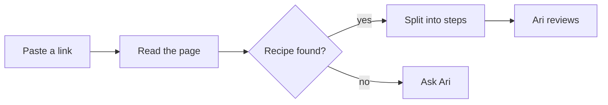

# Recipe import

**Plan by** your agent · **For** Ari · **Status:** In progress

Importing a recipe from a messy webpage should take one paste. This plan gets Spoonjoy there.

## At a glance

- Paste a link, get a recipe you can cook from
- Each ingredient lands on the step that uses it
- Nothing is saved until Ari reviews it

## How it works

## Test recipes

| Recipe | Steps | Ingredients placed | Notes |
| --- | --- | --- | --- |
|  |  |  |  |
|  |  |  |  |
|  |  |  |  |

## Next

- [x] Write the plan
- [ ] Run the test recipes
- [ ] Place ingredients on their steps
- [ ] Ari's review
